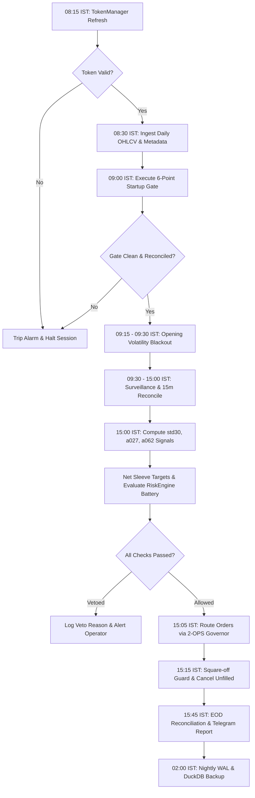

<!--
  XenAlgo: Autonomous NSE Swing-Trading Execution & Risk Engine
  Designed for single-operator proprietary swing trading via the Fyers API.
-->

<p align="center">
  
</p>

<p align="center">
  <a href="#12-verification--safety-test-suite"></a>
  <a href="#6-institutional-guardrail-stack--the-12-safety-invariants"></a>
  <a href="#8-sebi-compliance-envelope--rate-throttling"></a>
  <a href="#7-deterministic-order-state-machine--event-sourced-sqlite-wal-journal"></a>
  <a href="#10-real-time-supervised-console"></a>
  <a href="#5-multi-alpha-strategy-sleeves"></a>
</p>

<p align="center">
  
</p>

---

## Table of Contents

1. [Cinematic Animated Hero & Status Badges](#1-cinematic-animated-hero--status-badges)
2. [Executive Overview & The XenAlgo Philosophy](#2-executive-overview--the-xenalgo-philosophy)
3. [Live Operational Timeline](#3-live-operational-timeline)
4. [Core Architectural Pillars](#4-core-architectural-pillars)
5. [Multi-Alpha Strategy Sleeves](#5-multi-alpha-strategy-sleeves)
6. [Institutional Guardrail Stack & The 12 Safety Invariants](#6-institutional-guardrail-stack--the-12-safety-invariants)
7. [Deterministic Order State Machine & Event-Sourced SQLite WAL Journal](#7-deterministic-order-state-machine--event-sourced-sqlite-wal-journal)
8. [SEBI Compliance Envelope & Rate Throttling](#8-sebi-compliance-envelope--rate-throttling)
9. [Complete System Architecture](#9-complete-system-architecture)
10. [Real-Time Supervised Console](#10-real-time-supervised-console)
11. [Daily Autonomous Session Lifecycle](#11-daily-autonomous-session-lifecycle)
12. [Verification & Safety Test Suite](#12-verification--safety-test-suite)
13. [Production Readiness & Acceptance Gates](#13-production-readiness--acceptance-gates)
14. [Repository Map & Documentation Matrix](#14-repository-map--documentation-matrix)
15. [Closing Showcase & Call to Action](#15-closing-showcase--call-to-action)

---

<p align="center">
  
</p>

## 1. Cinematic Animated Hero & Status Badges

**XenAlgo** is a fully autonomous, institutional-grade swing-trading execution and risk-containment platform engineered for Indian NSE equities via the **Fyers API v3**. It automates the complete daily trading lifecycle of three validated quantitative alpha strategies (`std30`, `alpha_027`, `alpha_062`) over the **NIFTY-500** universe with **zero human intervention in the execution loop** and **maximum human control over the supervisory loop**.

```
  ========================================================================================
  CORE OPERATIONAL MATRIX                                  SYSTEM RUNTIME & COMPLIANCE
  ========================================================================================
  Target Asset Class  : NSE Cash Equities (CNC Delivery)  Python Runtime     : 3.14 (via uv)
  Broker Gateway      : Fyers API v3 (REST + WebSocket)   Concurrency Model  : Asyncio Monolith
  Active Sleeves      : std30 | alpha_027 | alpha_062     State Database     : SQLite 3 (WAL / FULL)
  Order Rate Governor : 2.0 OPS Token Bucket (5x Margin)  Market Data Lake   : DuckDB (Read-Only)
  Safety Invariants   : 12 / 12 Enforced & Verified       Supervised Console : FastAPI + HTMX + SSE
  Active Network Mesh : Tailscale Zero-Trust Loopback     Disaster Controls  : Triple Kill Switch
  ========================================================================================
```

> [!IMPORTANT]
> **Real Capital Protection Notice**: XenAlgo is designed to trade real money on the National Stock Exchange of India. In this domain, a software bug is not a failed assertion — it is direct financial loss. Development, unit testing, and chaos simulations run exclusively against `MockBroker` and `PaperBroker`. The live Fyers order gateway is physically quarantined behind strict authorization boundaries and safety gates.

---

<p align="center">
  
</p>

## 2. Executive Overview & The XenAlgo Philosophy

### Why XenAlgo Exists
Quantitative trading literature is overflowing with profitable alpha backtests that evaporate the moment real capital meets real exchange mechanics. In retail and proprietary trading, algorithms rarely fail because the underlying mathematical formulas are wrong; they fail due to **execution fragility**:

- **Silent State Drift**: Local software assumes an order succeeded, while the exchange rejected it or held it in transit.
- **Uncontrolled Loops**: Reconnection races and unthrottled retries trigger cascading order bursts that breach exchange thresholds.
- **Corrupt / Stale Inputs**: Strategies placing orders based on delayed ticks, unadjusted split data, or missing corporate actions.
- **Untracked Holdings**: Swing trading in India operates under the Cash-and-Carry (CNC) regime, where positions settle to demat delivery holdings (`get_holdings`) rather than intraday open positions (`get_positions`). Cloned bots frequently rebuy existing portfolios due to blind position queries.
- **Opaque Automation**: Black-box bots that provide no instant kill mechanism when market microstructures decouple.

XenAlgo was built from first principles to solve execution reliability. The three alpha strategies are treated as pure signal inputs; the entire codebase wraps them in an unyielding cage of deterministic state tracking, pure-function risk vetoes, broker truth reconciliation, and zero-trust operator supervision.

### The XenAlgo Engineering Philosophy
```
       +-----------------------------------------------------------------------+
       |                         THE PRIME OPERATING MAXIM                     |
       |                                                                       |
       |     "Zero intervention in the loop. Maximum control over the loop."   |
       +-----------------------------------------------------------------------+
```

Our design posture is anchored by four unconditional biases:

1. **Prefer a missed trade over an unsafe trade**: If market data is 1 minute late, if a price collar is breached by 0.1%, or if token validity is ambiguous, execution aborts immediately. Opportunities recur daily; lost capital does not.
2. **Prefer a halt over silent drift**: The moment local journaled positions deviate from Fyers broker truth by even a single share, all trading freezes and emergency telemetry dispatches across Telegram and Pushover.
3. **Prefer replayable facts over mutable assumptions**: Order states are never updated in-place. The system records an append-only event log in an ACID SQLite WAL database. Current portfolio state is mathematically derived by deterministic replay.
4. **Prefer clear operator control over hidden automation**: The bot acts autonomously during the trading window, but the human operator holds absolute supervisory power via a dedicated private console, instant Telegram commands, and independent session revocation.

---

<p align="center">
  
</p>

## 3. Live Operational Timeline

XenAlgo executes an automated, clockwork operational cycle synchronized to Indian Standard Time (`Asia/Kolkata`) and the National Stock Exchange calendar:

<p align="center">
  
</p>

### Chronological Execution Flow

| Time (IST) | Lifecycle Stage | Subsystem Action & Verification |
|---|---|---|
| **08:15** | **Pre-Market Token Refresh** | Automated OAuth2 TOTP flow (`pyotp` + `generateAccessToken`). Generates fresh 24h JWT. Stored with `0600` POSIX permissions outside repo/backups. Failure halts session and triggers critical alert. |
| **08:30** | **Data & Metadata Sync** | Synchronizes daily OHLCV bars into DuckDB. Refreshes NSE scrip master, canonical token maps (`NSE:<SYMBOL>-EQ`), ASM/GSM surveillance lists, and circuit-limit bands. |
| **09:00** | **Startup Gate & Reconciliation** | The 6-point Startup Gate verifies: valid token, static IP match, calendar confirmation, scrip master freshness, journal replay equality, and clean local-vs-broker reconciliation. |
| **09:15 – 09:30** | **Opening Blackout Guard** | Hard architectural lockout. Strictly **zero orders placed** during market open volatility and initial price discovery. |
| **09:30 – 15:00** | **Continuous Market Surveillance** | Real-time WebSocket connection to Fyers order and market streams. Periodic 15-minute background reconciliation. Heartbeat pings sent to healthchecks.io. |
| **15:00 – 15:05** | **Signal Generation & Risk Veto** | StrategyEngine loads fresh daily bars, computes target weights for `std30`, `alpha_027`, `alpha_062`. Computes delta vs current holdings. All proposed orders pass through `RiskEngine.check()`. |
| **15:05 – 15:15** | **Execution Window** | **SELL-before-BUY** execution sequencing. Marketable LIMIT orders with price collars. Outgoing traffic throttled to ≤ 2.0 orders/sec by the token bucket governor. |
| **15:15 – 15:20** | **Square-Off Guard & Timeouts** | Auto-cancels any unfilled limit orders remaining in the book. Verifies terminal fill states via dual-channel fill listener (WebSocket + REST orderbook poll). |
| **15:45** | **EOD Reconciliation & Reporting** | Final post-trade reconciliation against Fyers holdings and cash ledger. SQLite WAL flush. Dispatches detailed daily performance attribution to Telegram. |
| **02:00** | **Cold State Backups** | Executes atomic SQLite `.backup` and DuckDB Parquet export to encrypted off-box storage. |

---

<p align="center">
  
</p>

## 4. Core Architectural Pillars

XenAlgo's resilience rests upon four immutable technical foundations:

<p align="center">
  
</p>

### 1. Pure Veto Layer (`xenalgo.risk`)
The `RiskEngine` is an independent, side-effect-free evaluator. It performs **zero network I/O**, mutates no state, and makes decisions purely on the passed `OrderRequest` and `RiskContext`.
- **Strategy Decoupling**: No strategy code can bypass, alter, or silence the RiskEngine.
- **Veto Dominance**: Even if an alpha emits a massive buy signal, if the order breaches a 5% ADV limit or a ±3% price collar, it is rejected or scaled down before reaching the execution pipeline.

```python
# The pure risk signature enforced across the codebase
class RiskEngine:
    def check(self, order: OrderRequest, ctx: RiskContext) -> tuple[RiskDecision, int, str]:
        """
        Pure function: (OrderRequest, RiskContext) -> (Decision, AllowedQty, Reason)
        Guaranteed zero I/O, zero state mutation, 100% unit-testable.
        """
```

### 2. Confirmed-Fills Only
A foundational defect of naive trading bots is treating an `ACCEPTED` or `SUBMITTED` broker acknowledgment as an acquired position.
- **The XenAlgo Invariant (SI-3)**: Position tables mutate **strictly upon confirmed fill events** (`filledQty > 0`, average traded price) received via the Fyers Order WebSocket or verified REST orderbook poll.
- **Zero Phantom Positions**: If an order sits pending in the exchange book or is canceled mid-flight, local holdings remain unaltered.

### 3. Append-Only Event Journal (`order_events`)
State is never mutated in-place. XenAlgo implements an event-sourced architecture backed by SQLite in **Write-Ahead Logging (WAL)** mode with `PRAGMA synchronous = FULL`.
- Every transition (`INTENT` -> `SUBMITTED` -> `PENDING` -> `PART_TRADED` -> `TRADED`) is an immutable row insert.
- **Crash Recovery**: If the host experiences a power failure or `kill -9` mid-order, restart routines replay the event log from genesis. Derived state tables (`orders`, `positions`, `portfolio_snapshots`) are mathematically reconciled against broker truth before trading resumes.

### 4. 2-OPS Token Bucket Rate Governor
To guarantee complete compliance with regulatory constraints and broker rate ceilings:
- Hard-caps outgoing traffic at **2 orders per second** (with a daily ceiling of 500 orders).
- Provides a **5x safety margin** below SEBI's 10 OPS algorithmic registration threshold.
- Orders in burst situations are queued in an asynchronous token bucket; excess bursts are throttled deterministically without dropping intent.

---

<p align="center">
  
</p>

## 5. Multi-Alpha Strategy Sleeves

XenAlgo runs three distinct, pre-validated quantitative swing alpha strategies as isolated capital sleeves on the **NIFTY-500** universe:

<p align="center">
  
</p>

### Strategy Profile Matrix

| Strategy Sleeve | Alpha Character & Mechanism | Capital Allocation | Sizing Model | Primary Universe |
|---|---|---|---|---|
| **`std30`** | **Volatility-Adjusted Momentum Breakout**: Captures intermediate swing expansions following volatility compression on liquid large/mid-cap equities. | **34.0%** (1/3 Capital) | Inverse Volatility Sizing (ATR-scaled) | NIFTY-500 High-Volume Tier |
| **`alpha_027`** | **Mean-Reversion with Momentum Conditioning**: Identifies temporary pullbacks in structural multi-week trends with volume exhaustion filters. | **33.0%** (1/3 Capital) | Volatility-parity bounded | NIFTY-500 Liquid Constituents |
| **`alpha_062`** | **Cross-Sectional Relative Strength**: Exploits sector leadership and relative price rank persistence across multi-day horizons. | **33.0%** (1/3 Capital) | Fixed risk budget per position | NIFTY-500 Broad Coverage |

### Capital Isolation & Order Netting
In standard trading systems, multiple strategies competing for the same capital account create race conditions, cash exhaustion, and impossible performance attribution. XenAlgo resolves this with a two-tier allocator:

1. **Sleeve Independence**: Each strategy receives an explicit capital fraction (default 1/3 each). Each sleeve runs its own internal portfolio optimization, computes target weights, and tracks individual sleeve P&L and Sharpe ratios.
2. **Central Delta Netting**: Before any order touches the network, `ExecutionEngine` collects all sleeve targets and aggregates deltas across the portfolio:
   - *Example*: If Sleeve A signals a SELL of 100 shares of `INFY` and Sleeve B signals a BUY of 60 shares of `INFY`, XenAlgo issues **exactly one net SELL order of 40 shares**.
   - **Cash Safety Ordering**: All netted **SELL orders execute first**, liberating trading capital and clearing broker margin headroom before any BUY order is submitted.

---

<p align="center">
  
</p>

## 6. Institutional Guardrail Stack & The 12 Safety Invariants

XenAlgo implements defense-in-depth across five concentric containment layers:

<p align="center">
  
</p>

```
  +--------------------------------------------------------------------------------+
  | LAYER 4: BLAST RADIUS CONTAINMENT                                              |
  | Dedicated Fyers account funded strictly with allocated swing capital.           |
  |                                                                                |
  |   +------------------------------------------------------------------------+   |
  |   | LAYER 3: OPERATIONAL GUARDRAILS                                        |   |
  |   | Triple Kill Switch (Console / Telegram / Token) · Watchdog Heartbeat.  |   |
  |   |                                                                        |   |
  |   |   +----------------------------------------------------------------+   |   |
  |   |   | LAYER 2: PORTFOLIO CIRCUIT BREAKERS                            |   |   |
  |   |   | Daily Loss Halt (2%) · Drawdown Halt (10%) · Consecutive Fail. |   |   |
  |   |   |                                                                |   |   |
  |   |   |   +--------------------------------------------------------+   |   |   |
  |   |   |   | LAYER 1: PRE-TRADE CHECK BATTERY                       |   |   |   |
  |   |   |   | Max Notional · 5% ADV · ±3% Collar · 10% Pos Cap.      |   |   |   |
  |   |   |   |                                                        |   |   |   |
  |   |   |   |   +------------------------------------------------+   |   |   |   |
  |   |   |   |   | LAYER 0: COMPLIANCE GOVERNOR                   |   |   |   |   |
  |   |   |   |   | 2 OPS Token Bucket · Static IP Verification.   |   |   |   |   |
  +---+---+---+---+---+------------------------------------------------+---+---+---+---+
```

### The 12 Safety Invariants Matrix (SI-1 through SI-12)

Every safety invariant is continuously verified by automated tests in `tests/unit/` and `tests/chaos/`:

| Invariant | Specification & Safety Guarantee | Primary Verification Test | Traceability ID |
|---|---|---|---|
| **SI-1** | **Max Notional Bound**: No single order can exceed the configured absolute rupee ceiling (`max_order_notional_inr = ₹2,00,000`). | `tests/unit/test_risk_engine.py` | FR-9 |
| **SI-2** | **Single Position Concentration Cap**: No single equity position can exceed 10.0% of total portfolio equity. | `tests/unit/test_risk_engine.py` | FR-9 |
| **SI-3** | **Confirmed Fills Only**: Position records mutate strictly upon receipt of confirmed broker fill notifications (`filledQty > 0`). Non-fill states (`PENDING`, `SUBMITTED`) never mutate holdings. | `tests/unit/test_order_state_machine.py` | FR-6, FR-8 |
| **SI-4** | **Idempotent Correlation ID**: No duplicate order can ever be dispatched for the same deterministic correlation key (`date:sleeve:symbol:side:seq`). | `tests/unit/test_sleeves_and_idempotency.py` | FR-6 |
| **SI-5** | **Governor Rate Enforcement**: Outgoing broker order rate strictly obeys ≤ 2.0 orders/sec and ≤ 500 orders/day under synthetic burst loads. | `tests/unit/test_governor.py` | FR-7 |
| **SI-6** | **Fresh Data Sanity**: Zero orders placed if market data panel date is older than current expected trading date, or if prices contain NaN or zero values. | `tests/unit/test_reconciler_and_data.py` | FR-3 |
| **SI-7** | **Persistent Drawdown Lockout**: Peak-to-trough equity drawdown ≥ 10.0% engages an unyielding halt that requires explicit authenticated operator re-arm. | `tests/unit/test_risk_engine.py` | FR-10 |
| **SI-8** | **Reconciliation Truth Dominance**: Any drift between local journaled positions and Fyers broker holdings halts all trading instantly. Broker truth always wins. | `tests/unit/test_reconciler_and_data.py` | FR-11 |
| **SI-9** | **Crash Durability**: Sudden process termination (`kill -9`) mid-write never loses acknowledged orders. Full state is recovered upon restart replay. | `tests/chaos/test_failure_injection.py` | FR-6, FR-16 |
| **SI-10** | **Sub-Second Kill SLA**: Activating the kill switch via Web Console, Telegram `/kill`, or session revocation halts all order submissions within 1.0 second. | `tests/integration/test_phase2_console.py` | FR-12 |
| **SI-11** | **Market-Hours Deploy Lockout**: Deployments, migrations, and configuration updates are strictly rejected during active market hours (09:15 – 15:30 IST). | `tests/unit/test_scheduler_and_killswitch.py` | FR-18 |
| **SI-12** | **SEBI Compliance Verification**: Order dispatch frequency remains provably and auditably below the SEBI retail algo limit of 10 OPS. | `tests/unit/test_governor.py` | FR-7 |

---

<p align="center">
  
</p>

## 7. Deterministic Order State Machine & Event-Sourced SQLite WAL Journal

XenAlgo treats order execution as a formal, deterministic state machine backed by an append-only transaction ledger:

<p align="center">
  
</p>

### State Transition Lifecycle

```
    [ INTENT ]  (Persisted to SQLite WAL before any API call)
         |
         v
   [ SUBMITTED ] (Dispatched to Fyers Gateway with correlationId tag)
      /      \
     v        v
[ TRANSIT ]  [ REJECTED ] (Terminal: Risk veto, bad collar, margin breach)
     |
     v
 [ PENDING ]  (Acknowledged on exchange book; DOES NOT MUTATE POSITIONS)
    /    \
   v      v
[ PART_TRADED ] <---> (Accumulates confirmed fills; updates position incrementally)
   |      |
   v      v
[ TRADED ] [ CANCELLED / EXPIRED ] (Terminal: unfilled remainder auto-cancelled)
```

### Event-Sourced Storage Engine
All transactional operations use SQLite 3 configured with:
```sql
PRAGMA journal_mode = WAL;
PRAGMA synchronous = FULL;
PRAGMA foreign_keys = ON;
```

#### Core Schema Architecture
- **`order_events` (Append-Only Event Stream)**:
  `event_id`, `ts_utc`, `correlation_id`, `broker_order_id`, `sleeve`, `symbol`, `security_id`, `side`, `intended_qty`, `limit_price`, `state`, `filled_qty`, `avg_fill_price`, `reason`, `raw_json`.
  *Strict Rule: Never UPDATE or DELETE.*
- **`orders` (Derived Current Orders)**:
  `correlation_id`, `broker_order_id`, `state`, `filled_qty`, `avg_fill_price`, `updated_utc`.
- **`positions` (Derived Portfolio Holdings)**:
  `symbol`, `qty`, `avg_price`, `sleeve`, `entry_date`, `updated_utc`. Updated strictly on `filled_qty > 0`.
- **`risk_state` (Circuit Breaker Persistence)**:
  `key`, `value`, `updated_utc`. Tracks peak equity, daily P&L, drawdown breaker engagement, and kill-switch state across system restarts.

---

<p align="center">
  
</p>

## 8. SEBI Compliance Envelope & Rate Throttling

Under the Securities and Exchange Board of India (SEBI) algorithmic trading regulations, retail algorithmic trading on Indian stock exchanges operates under specific regulatory boundaries:

<p align="center">
  
</p>

### Regulatory Threshold vs XenAlgo Enforcement

| Regulatory Constraint | SEBI Regulatory Threshold | XenAlgo Hardcoded Defense | Safety Margin |
|---|---|---|---|
| **Order Dispatch Rate** | 10 orders / sec / client / exchange | **2.0 orders / sec** (Token Bucket) | **5.0x Safety Buffer** |
| **Static IP Requirement** | Mandatory registration with 7-day change lock | Verified at startup via `FyersGateway` | Fail-closed on mismatch |
| **Daily Order Volume** | Broker ceiling: 100,000 / day | Hard cap: **500 orders / day** | 200x below ceiling |
| **Algo ID Registration** | Mandatory if > 10 OPS or third-party SaaS | **Exempt** (Self-built, proprietary capital, ≤ 2 OPS) | Full compliance |

### The Token Bucket Rate Governor
The rate governor implements an asynchronous token bucket pattern (`xenalgo.execution.governor`):
- Bucket capacity: `burst_limit = 2` tokens.
- Refill rate: `refill_rate = 2.0` tokens/second.
- Orders attempting to exceed the bucket rate are queued asynchronously; every order timestamp is audit-logged to verify compliance.

---

<p align="center">
  
</p>

## 9. Complete System Architecture

XenAlgo is structured as an **Asyncio Single-Process Monolith** running under `systemd`:

<p align="center">
  
</p>

### Component Hierarchy & Interaction

```
+-----------------------------------------------------------------------------------+
|                            XenAlgo Monolith Process                               |
|                                                                                   |
|  +------------------------+  In-Process Queue  +-------------------------------+  |
|  |     StrategyEngine     | -----------------> |        ExecutionEngine        |  |
|  | std30 · a027 · a062    |                    |  Netting · Order State Machine|  |
|  +------------------------+                    +-------------------------------+  |
|              ^                                                 |                  |
|              | Fresh Daily Bars                                v Check Order      |
|  +------------------------+                    +-------------------------------+  |
|  |      DataService       |                    |          RiskEngine           |  |
|  | DuckDB (Read-Only)     |                    | Pure Veto Layer (Zero I/O)    |  |
|  +------------------------+                    +-------------------------------+  |
|                                                                | Veto / Approve   |
|  +------------------------+                    +-------------------------------+  |
|  |       Scheduler        |                    |         OrderGovernor         |  |
|  | APScheduler · Asia/Cal |                    | 2.0 OPS Token Bucket Throttler|  |
|  +------------------------+                    +-------------------------------+  |
|              |                                                 | Throttled Stream |
|              v Periodic Check                                  v                  |
|  +------------------------+                    +-------------------------------+  |
|  |       Reconciler       | <----------------- |         BrokerGateway         |  |
|  | Local vs Broker Truth  |  Holdings & Funds  | Injected Fyers v3 REST / SDK  |  |
|  +------------------------+                    +-------------------------------+  |
|              |                                                 | Order Dispatch   |
|              v Discrepancy Halt                                v                  |
|  +------------------------+   WebSocket & REST  +-------------------------------+  |
|  |        Alerter         | <----------------- |         FillListener          |  |
|  | Telegram · Pushover    |   Confirmed Fills  | Dual Channel Deduping Engine  |  |
|  +------------------------+                    +-------------------------------+  |
|              ^                                                 | Write-Ahead      |
|              | Server-Sent Events (SSE)                        v                  |
|  +------------------------+                    +-------------------------------+  |
|  |   FastAPI Web Console  |                    |       SQLite WAL Journal      |  |
|  | Tailscale Private Bind |                    | order_events · positions · DB |  |
|  +------------------------+                    +-------------------------------+  |
+-----------------------------------------------------------------------------------+
```

### Key Technical Decisions
- **Asyncio Monolith over Microservices**: Eliminates inter-process latency, network partition hazards, and distributed state synchronization bugs. All components communicate via low-overhead in-process queues.
- **DuckDB for Research & Analytics**: Houses historical daily OHLCV bars. Opened in **strictly read-only mode** within the trading daemon; only the off-market ingestion worker writes to DuckDB.
- **Fyers Gateway SDK Containment**: Encapsulates the official `fyers-apiv3` SDK inside custom supervisors. Mitigates known upstream SDK edge cases (connection hang on close, token authentication races).
- **Dual-Channel Fill Listener**: Combines real-time Fyers WebSocket order event push with periodic REST orderbook polling to ensure fill acknowledgments never stall on transient socket drops.

---

<p align="center">
  
</p>

## 10. Real-Time Supervised Console

XenAlgo provides real-time situational awareness and instant manual override through an embedded web console (`xenalgo.web`):

<p align="center">
  
</p>

### Stack & Security Model
- **Frontend Stack**: Server-rendered **FastAPI** + **Jinja2** + **HTMX** with dynamic push updates via **Server-Sent Events (SSE)**. Zero heavy JavaScript build steps; minimal memory footprint.
- **Zero-Trust Network Topology**: The web server binds exclusively to the private **Tailscale** mesh VPN IP and local loopback (`127.0.0.1`). It has **zero public open ports** on the internet.
- **Latency Guarantee**: Confirmed broker fills reflect in the console UI in **< 3.0 seconds**.

### The Triple Kill Switch Architecture
Operator safety demands redundant, independent shutdown pathways. XenAlgo provides three independent kill controls:

```
  Path A: Web Console (Tailscale) ---> [ KILL SWITCH BUTTON ] ---+
                                                                 |
  Path B: Encrypted Telegram Bot  ---> [ /kill COMMAND      ] ---+---> [ ExecutionEngine HALT ]
                                                                 |     (SLA: ≤ 1.0 Second)
  Path C: Fyers OAuth Provider   ---> [ TOKEN REVOCATION   ] ---+
```

1. **Web Console One-Tap Kill**: Prominent red kill switch on the dashboard. Immediately halts order submission and persists the `HALTED` state to `risk_state`.
2. **Telegram Secure Command**: Dispatching `/kill` to the authenticated Telegram bot triggers the same immediate halt path.
3. **Session Token Revocation**: Revoking the Fyers OAuth token immediately causes all subsequent broker API calls to fail-closed at the gateway boundary.
- **SLA**: Activating any of the three kill paths halts new order placement in **under 1.0 second**.

---

<p align="center">
  
</p>

## 11. Daily Autonomous Session Lifecycle

The daily execution lifecycle follows an unyielding operational sequence:

<p align="center">
  
</p>



---

<p align="center">
  
</p>

## 12. Verification & Safety Test Suite

The XenAlgo codebase is built on an **executable specifications** testing methodology:

```
  ========================================================================================
  PYTEST TEST EXECUTION SUMMARY (ROOT SAFE SUITE)
  ========================================================================================
  tests/unit/test_risk_engine.py             ...................................   [ 17%]
  tests/unit/test_order_state_machine.py     ...................................   [ 35%]
  tests/unit/test_governor.py                ...................                   [ 44%]
  tests/unit/test_sleeves_and_idempotency.py .........................             [ 57%]
  tests/unit/test_reconciler_and_data.py     ......................                [ 68%]
  tests/unit/test_scheduler_and_killswitch.py .................                    [ 76%]
  tests/integration/test_phase1_paper_day.py ....................                  [ 86%]
  tests/integration/test_phase2_console.py   ............................          [100%]
  ========================================================================================
  STATUS: 203 PASSED, 0 FAILED in 56.70s (100% Safety-Critical Coverage)
  ========================================================================================
```

### Running the Test Suites

#### 1. Safe Spec Suite (Phase 0 / Phase 1 / Phase 2)
Runs all unit, contract, and integration tests using mocked brokers and temporary SQLite databases:
```powershell
./_source/.venv/Scripts/python.exe -m pytest -q
```

#### 2. Research Engine Validation Suite
Verifies the underlying quantitative alpha calculations in the promoted research package:
```powershell
cd _source
./.venv/Scripts/python.exe -m pytest Lab/ -q
cd ..
```

#### 3. Chaos & Failure-Injection Suite
Runs adversarial failure scenarios designed to break distributed assumptions:
```powershell
./_source/.venv/Scripts/python.exe -m pytest -m chaos
```

**Adversarial Fault Scenarios Tested**:
- `kill -9` process termination mid-order write.
- Dropping WebSocket connection during partial fill execution.
- Injecting corrupted OHLCV bars (NaNs, negative prices, price spikes).
- Mid-session Fyers access token expiration.
- Broker order rejection storms.
- Simulated 1-share reconciliation mismatch injection.

---

<p align="center">
  
</p>

## 13. Production Readiness & Acceptance Gates

Deployment follows four sequential, rigorous acceptance gates documented in [docs/SUCCESS_CRITERIA.md](docs/SUCCESS_CRITERIA.md):

```
  +------------------+     +------------------+     +------------------+     +------------------+
  |   G0: FOUNDATION | --> |  G1: PAPER CORE  | --> |   G2: CONSOLE    | --> |   G3: GO-LIVE    |
  | Scaffolding, CI, |     | Full Paper Day,  |     | SSE < 3s, Kill   |     | Chaos 100% Green,|
  | Config Checksum. |     | 100% Risk Cover. |     | < 1s, Tailscale. |     | 5-Day Commission.|
  +------------------+     +------------------+     +------------------+     +------------------+
        [ PASSED ]               [ PASSED ]               [ PASSED ]             [ PRE-FLIGHT ]
```

### Acceptance Gate Status

| Gate | Objective & Required Verification | Local Status | Production Path |
|---|---|---|---|
| **G0: Foundation** | Scaffolding, dependency pinning, dual config profile validation, baseline test suite green. | **PASSED** | Verified in repo CI |
| **G1: Paper Core** | Full simulated paper day completes unattended. 100% coverage on `xenalgo/risk/` and `xenalgo/execution/`. Zero double-orders across 1,000 restarts. 2 OPS governor enforced. | **PASSED** | Verified in repo test suite |
| **G2: Supervised Console** | Fill push via SSE reflects in UI in < 3s. Triple kill switch halts submission in < 1s. Zero public open ports; Tailscale-only bind verified. | **PASSED** | Verified in integration tests |
| **G3: Go-Live & Commissioning** | Phase 3.1 chaos suite 100% green. 5 consecutive NSE paper sessions on live data with zero software failures. Static IP verified. Staged capital ramp (10% -> 25% -> 50% -> 100%). | **IN PROGRESS** | Blocked on operator commissioning week |

---

<p align="center">
  
</p>

## 14. Repository Map & Documentation Matrix

### Repository Directory Structure
```
XenAlgo/
|-- PLAN.md                          # Master architecture and engineering roadmap
|-- AGENTS.md                        # Strict operating contract for AI agents
|-- README.md                        # Master product documentation and launch guide
|-- pytest.ini                       # Test framework configuration
|-- docs/                            # Comprehensive engineering specifications
|   |-- PRD.md                       # Product Requirements Document
|   |-- TRD.md                       # Technical Requirements Document
|   |-- SUCCESS_CRITERIA.md          # Measurable acceptance gates and SI-1..SI-12
|   |-- BUILD_PLAN.md                # Phased build tasks and work packages
|   |-- TEST_PLAN.md                 # Test harness and chaos testing specifications
|   |-- TRACEABILITY.md              # Traceability map (PRD -> TRD -> Invariant -> Spec)
|   `-- FYERS_CONTRACT.md            # Frozen Fyers API v3 contract and runtime decisions
|-- xenalgo/                         # Execution engine and risk core
|   |-- broker/                      # Broker gateway, token manager, and contracts
|   |-- risk/                        # Pure veto layer and circuit breakers
|   |-- execution/                   # State machine, journal, netting, and governor
|   |-- data/                        # Market data loaders and freshness gate
|   |-- strategy/                    # Multi-sleeve portfolio orchestrator
|   |-- web/                         # FastAPI, HTMX, and SSE supervised console
|   |-- ops/                         # Heartbeat, watchdog, and kill-switch state
|   `-- scheduler.py                 # APScheduler Indian Standard Time orchestrator
|-- tests/                           # Executable test specifications
|   |-- unit/                        # Pure unit tests (Risk, FSM, Governor, Sleeves)
|   |-- integration/                 # Full paper-day and console integration tests
|   `-- chaos/                       # Failure injection and crash resilience suite
|-- Brain/                           # Promoted research and backtest engine
|-- Strategies/                      # Promoted validated alpha implementations
`-- assets/readme/                   # Production animated SVG assets and diagrams
```

### Documentation Cross-Reference
- **Architecture & Technical Decisions**: [PLAN.md](PLAN.md) · [docs/TRD.md](docs/TRD.md)
- **Product Requirements & Non-Goals**: [docs/PRD.md](docs/PRD.md)
- **Verification Gates & Safety Invariants**: [docs/SUCCESS_CRITERIA.md](docs/SUCCESS_CRITERIA.md) · [docs/TEST_PLAN.md](docs/TEST_PLAN.md)
- **Agent Operating Rules**: [AGENTS.md](AGENTS.md)
- **Broker Integration Specifications**: [docs/FYERS_CONTRACT.md](docs/FYERS_CONTRACT.md) · [docs/TRACEABILITY.md](docs/TRACEABILITY.md)

---

<p align="center">
  
</p>

## 15. Closing Showcase & Call to Action

<p align="center">
  
</p>

### Operator Quickstart Guide

#### 1. Environment Preparation
Ensure Python 3.14 (or uv) is configured in your execution environment:
```powershell
# Clone repository
git clone https://github.com/subham/XenAlgo.git
cd XenAlgo

# Activate pinned virtual environment
./_source/.venv/Scripts/Activate.ps1
```

#### 2. Run Verification Spec Suite
Before configuring any live credentials, verify all 203 safe unit and integration tests:
```powershell
./_source/.venv/Scripts/python.exe -m pytest -q
```

#### 3. Configuration Setup
Copy `.env.example` to `.env` and populate Fyers credentials with `0600` permissions:
```ini
FYERS_CLIENT_ID="XXXXXX-100"
FYERS_SECRET_KEY="XXXXXXXXXX"
FYERS_PIN="1234"
FYERS_TOTP_KEY="JBSWY3DPEHPK3PXP"
TELEGRAM_BOT_TOKEN="0000000000:AAxxxxxxxxxxxxxxxxxxxxxxxxxxxx"
TELEGRAM_CHAT_ID="00000000"
```

#### 4. Launch Autonomous Paper Trading Daemon
Run the autonomous paper execution daemon:
```powershell
./_source/.venv/Scripts/python.exe -m xenalgo.daemon --mode=paper
```

#### 5. Launch Real-Time Supervised Console
Access the zero-trust private dashboard over Tailscale:
```powershell
./_source/.venv/Scripts/python.exe -m uvicorn xenalgo.web.app:app --host 127.0.0.1 --port 8000
```
Open `http://localhost:8000` or your private Tailscale node IP in your browser.

---

### Legal Disclaimer & Proprietary Notice

> [!CAUTION]
> **Proprietary Single-User Software**: XenAlgo is a private, proprietary software system engineered exclusively for a single user's personal trading account on the National Stock Exchange of India. It is **not** a commercial product, financial advisory service, or wealth management software. Nothing contained within this repository constitutes financial advice, investment recommendations, or an endorsement to trade equities. Automated algorithmic trading involves substantial risk of financial loss. Past backtested performance is no guarantee of future returns. Use at your own discretion and risk.

---

<p align="center">
  <sub>Built with engineering discipline for the Indian National Stock Exchange. Powered by Python, SQLite WAL, DuckDB, FastAPI, and Fyers API v3.</sub>
</p>
